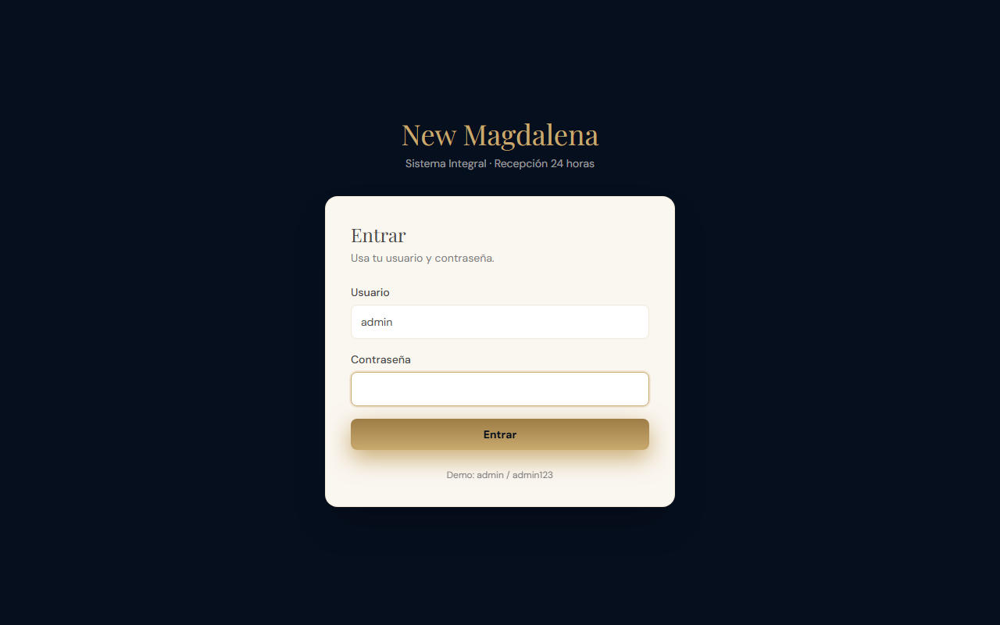

# SINMH — Sistema Integral New Magdalena Hotel

Sistema para reemplazar el SIMP (reservas y check-in) y las planillas de Excel (caja y bar), con una sola fuente de verdad para la operación del hotel.

**Estado:** Franja 0 en marcha. Backend con login JWT, health y base embebida funcionando. La primera versión es **recepción 24 horas**: alojamiento walk-in, reservas simples, folios, cobros, caja con turnos, bar recepción y roles.

## Documentos

- [alcance-sistema.md](docs/alcance-sistema.md) — **alcance vigente de todo el sistema**.
- [SPEC.md](docs/SPEC.md) — documento histórico; el alcance vigente manda.
- [procesos-operativos.md](docs/procesos-operativos.md) — cómo opera hoy el hotel.
- [datos-existentes.md](docs/datos-existentes.md) — qué hay en el SIMP y en las planillas, y cómo migrarlo.
- [tarifas.md](docs/tarifas.md) — matriz de precios, escenarios y temporadas.
- [impuestos.md](docs/impuestos.md) — IVA e impoconsumo explicados.
- [inventario-habitaciones.md](docs/inventario-habitaciones.md) — habitaciones, capacidades y climatización.
- [decisiones.md](docs/decisiones.md) — decisiones de arquitectura y alcance.
- [design.md](docs/design.md) — esquema de base de datos propuesto.
- [design-system.md](docs/design-system.md) — identidad visual.

## Datos

- `seeds/habitaciones.csv` — inventario de habitaciones.
- `seeds/tarifas.csv` — matriz de precios.

Los archivos con datos personales (`datos y procesos/`) no se versionan.

## Backend

```bash
cd backend
npm install
npm run migrate
npm run seed
npm run dev
```

- API: `http://localhost:3000`
- Health: `GET /health`
- Login: `POST /auth/login` con `admin` / `admin123`
- Catálogo: `GET /habitaciones` y `GET /tarifas` (requieren token)
- Disponibilidad: `GET /disponibilidad?desde=2026-11-20&hasta=2026-11-22&pax=2`
- Cotización: `GET /tarifas/cotizar?habitacion_id=1&pax=2&temporada=BAJA&escenario=NORMAL`
- Check-in: `POST /checkin` (cliente, reserva, huésped, folio, cargos y cobro)
- Caja: `GET /caja/sesion-actual`, `POST /caja/sesiones`, `POST /caja/sesiones/:id/cerrar`
- Folios: `GET /folios`, `GET /folios/:id`, `POST /folios/:id/checkout`
- Reportes: `GET /reportes/ingresos?fecha=...`, `GET /reportes/ocupacion`, `GET /reportes/libro?desde=...&hasta=...`, `GET /reportes/desayunos?fecha=...`
- Recibo PDF: `GET /cobros/:id/recibo`
- Administración: `GET /admin/usuarios`, `GET /admin/roles`, `POST /admin/usuarios`, `PUT /admin/usuarios/:id`
- Cargos manuales: `POST /folios/:id/cargos`, `GET /catalogos/centros`
- Bar recepción: `GET /productos`, `POST /productos`, `GET /bar/ventas`, `POST /bar/ventas`
- Semilla: 33 habitaciones, 31 rentables y 50 tarifas
- Base: PostgreSQL embebido (PGlite) en `backend/.data`; el mismo esquema corre en PostgreSQL real.
- Los datos de `datos y procesos/` no se versionan.

## Frontend

```bash
cd frontend
npm install
npm run dev
```

- URL: `http://127.0.0.1:5173`
- Login: `admin` / `admin123`
- Consume la API en `http://localhost:3000`.




## Todo desde la raíz

```bash
npm install
npm run dev
```

Levanta la API y la web al mismo tiempo con `concurrently`.

## Siguiente paso

Bar recepción listo: productos, ventas, stock, efectivo/tarjeta y cargo a la habitación. Sigue **caja avanzada**: gastos, retiros del dueño, aportes y traslados.

## Repositorio remoto

Pendiente de crear y enlazar. El repositorio local ya está inicializado en `main`.
