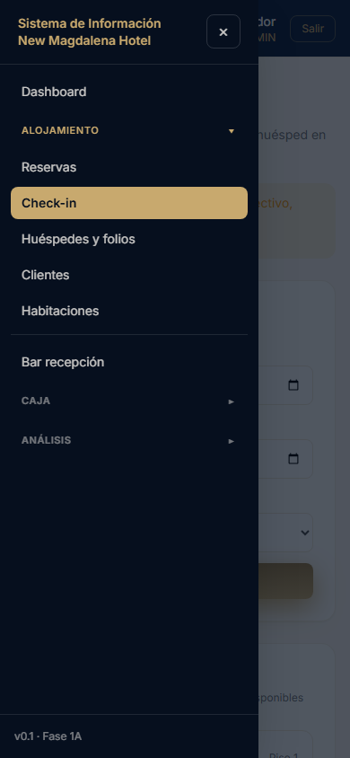
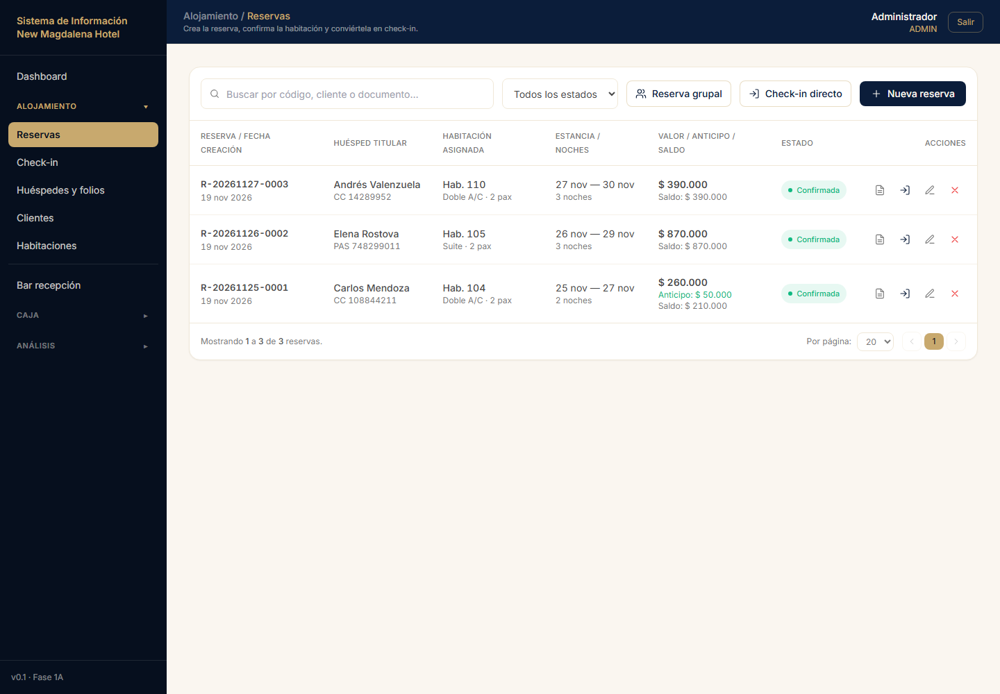
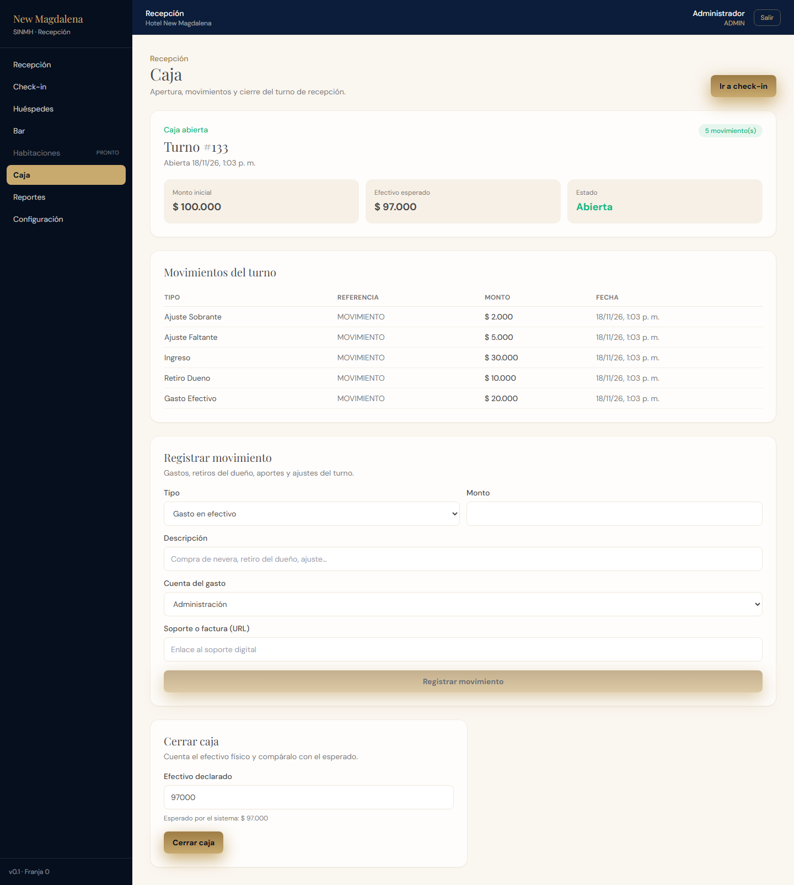
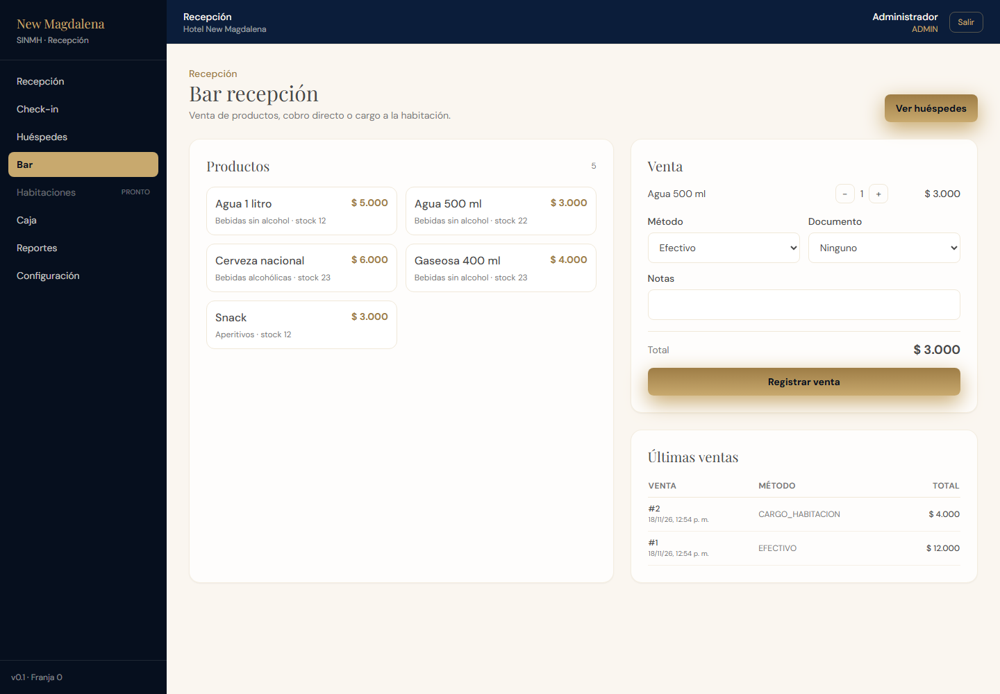
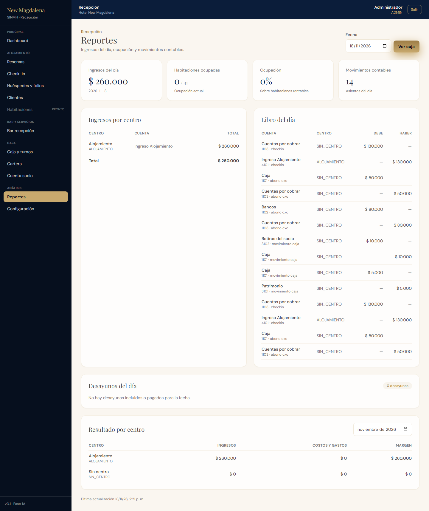

# SINMH — Sistema Integral New Magdalena Hotel

Sistema para reemplazar el SIMP (reservas y check-in) y las planillas de Excel (caja y bar), con una sola fuente de verdad para la operación del hotel.

**Estado:** 1A operativa y financiera implementadas. Funcionan reservas con
anticipo, edición y contrato, check-in, folios, cargos, check-out, caja con
traslados y cambio de turno, contabilidad, reportes, usuarios, bar recepción,
clientes con crédito, cuentas por cobrar, abonos, cuenta socio, tablero de
habitaciones, dashboard, menú desplegable y móvil, y cuadre de caja en PDF.
Falta la validación manual y compras/inventario del bar.

## Documentos

- [SPEC.md](docs/SPEC.md) — alcance, módulos y reglas de negocio.
- [requirements.md](docs/requirements.md) — requisitos con criterios de aceptación.
- [design.md](docs/design.md) — arquitectura del frontend, pantallas y base de datos.
- [design-system.md](docs/design-system.md) — identidad visual.
- [tasks.md](docs/tasks.md) — plan por módulos y estado real.

## Datos

- `seeds/habitaciones.csv` — inventario de habitaciones.
- `seeds/tarifas.csv` — matriz de precios.

Los archivos con datos personales (`datos y procesos/`) no se versionan.

## Backend

```bash
cd backend
npm install
npm run migrate
npm run seed
npm run dev
```

- API: `http://localhost:3000`
- Health: `GET /health`
- Login: `POST /auth/login` con `admin` / `admin123`
- Catálogo: `GET /habitaciones` y `GET /tarifas` (requieren token)
- Tablero: `GET /habitaciones/tablero`, `PUT /habitaciones/:id/estado`
- Disponibilidad: `GET /disponibilidad?desde=2026-11-20&hasta=2026-11-22&pax=2`
- Cotización: `GET /tarifas/cotizar?habitacion_id=1&pax=2&temporada=BAJA&escenario=NORMAL`
- Check-in: `POST /checkin` (cliente, reserva, huésped, folio, cargos y cobro)
- Reservas: `GET/POST /reservas`, `PUT /reservas/:id`, `POST /reservas/:id/cancelar`, `POST /reservas/:id/checkin`, `GET /reservas/:id/contrato`, anticipo opcional
- Clientes: `GET/POST /clientes`, `PUT /clientes/:id`
- Cartera: `GET /cuentas-cobrar`, `GET /cuentas-cobrar/:id`, `POST /cuentas-cobrar/:id/abonos`
- Cuenta socio: `GET /caja/cuenta-socio`
- Caja: `GET /caja/sesion-actual`, `GET /caja/puntos-venta`, `GET /caja/sesiones-abiertas`, `POST /caja/sesiones`, `POST /caja/sesiones/:id/cerrar`
- Caja avanzada: `POST /caja/movimientos`, `POST /caja/traslados`, `POST /caja/sesiones/:id/cambio-turno`, `GET /caja/sesiones/:id/cuadre.pdf`
- Folios: `GET /folios`, `GET /folios/:id`, `POST /folios/:id/checkout`
- Reportes: `GET /reportes/ingresos?fecha=...`, `GET /reportes/ocupacion`, `GET /reportes/libro?desde=...&hasta=...`, `GET /reportes/desayunos?fecha=...`, `GET /reportes/resultado-centros?mes=...`
- Recibo PDF: `GET /cobros/:id/recibo`
- Administración: `GET /admin/usuarios`, `GET /admin/roles`, `POST /admin/usuarios`, `PUT /admin/usuarios/:id`
- Cargos manuales: `POST /folios/:id/cargos`, `GET /catalogos/centros`
- Bar recepción: `GET /productos`, `POST /productos`, `GET /bar/ventas`, `POST /bar/ventas`
- Semilla: 33 habitaciones, 31 rentables y 50 tarifas
- Base: PostgreSQL embebido (PGlite) en `backend/.data`; el mismo esquema corre en PostgreSQL real.
- Los datos de `datos y procesos/` no se versionan.

## Frontend

```bash
cd frontend
npm install
npm run dev
```

- URL: `http://127.0.0.1:5173`
- Login: `admin` / `admin123`
- Consume la API en `http://localhost:3000`.

















## Todo desde la raíz

```bash
npm install
npm run dev
```

Levanta la API y la web al mismo tiempo con `concurrently`.

## Guía rápida de prueba 1A

1. Abre caja de recepción.
2. Crea una reserva con anticipo y edítala.
3. Haz check-in desde la reserva.
4. Agrega un cargo y haz check-out.
5. Crea una empresa en Clientes, reserva a su nombre y haz check-out a crédito.
6. Abona en Cartera y revisa Cuenta socio.
7. Abre bar terraza, traslada efectivo a recepción y haz cambio de turno.
8. Genera el cuadre PDF y revisa Reportes.

## Siguiente paso

La 1A está implementada y lista para validación manual. Después siguen compras,
almacenes, traslados de inventario y crédito de empleados del bar; luego la
Fase 1B (mensualidad, contratos y extensiones).

## Repositorio remoto

`https://github.com/newmagdalenahotel-ux/sinmh` — rama `main`.
